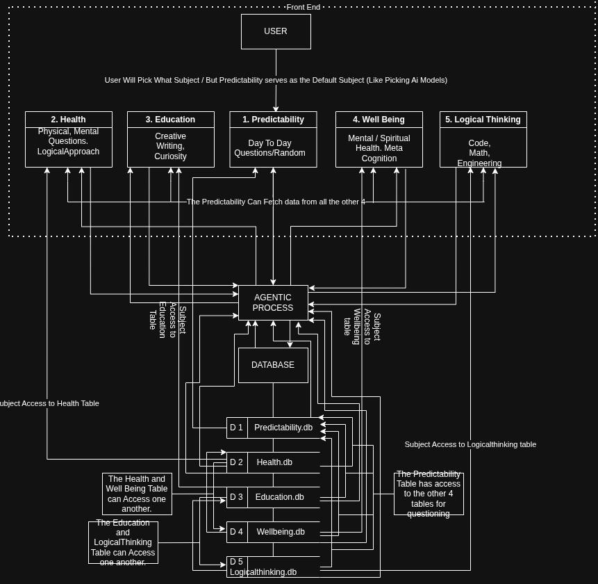

<<<<<<< HEAD
lear# Callama
=======
# Callama
>>>>>>> origin/main

To Start Project:

*Make sure Ollama is running and has a model.
*The llama3.2:3b is set to Default in the package.json

ollama serve &
ollama pull llama3.2:3b

*Run the app

npm start

I Just Woke Up and Started to Make My own Custom Ai 

